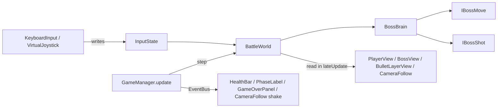

# BulletHell — 2D boss fight demo (Cocos Creator 3.7.4)

A top-down bullet-hell boss battle made for the FGS Client Developer Exercise.
Player = blue circle, player bullets = green circles, boss = red square, boss bullets = orange circles,
inside a large rectangular arena closed by four walls.

## How to run

- **Editor**: open the folder with Cocos Creator **3.7.4** (Dashboard → Projects → Add), open
  `assets/scenes/Main.scene`, press Preview.
- **Web build**: `build/web-mobile/` (not committed; produce it with Project → Build → Web Mobile, or
  `CocosCreator.exe --project <this folder> --build "platform=web-mobile;debug=false"`), then serve it with any
  static server, e.g. `npx http-server build/web-mobile -p 8080`, and open `http://localhost:8080`.

- **Android**: `release/BulletHell.apk` (arm64-v8a, Android 5.0+, landscape). Rebuild: set the Android SDK and
  NDK r21e in Preferences → Program Manager, install JDK 11 (Gradle 6.5 / AGP 4.1 used by 3.7.4), then
  Project → Build → Android (or the same CLI command with `platform=android`) and `gradlew assembleRelease` in
  `build/android/proj`.

### Controls

| Platform | Move | Dash | Shoot |
| --- | --- | --- | --- |
| Desktop | WASD or arrow keys | Space or Shift | automatic when the boss is within range |
| Touch devices | drag on the left half of the screen (floating joystick) | DASH button (bottom right) | automatic |

## Constraints of the brief

- **No project template examples**: the project was created from the *Empty (2D)* template (a blank project);
  no code or asset comes from an example project.
- **No third-party packages**: `package.json` has no dependencies and the code only imports the engine (`cc`).
  The sprites (white circle and square) and every sound were generated by code for this project.

## Features

Required by the brief, all done:
- Simple shapes with the required colours; large enclosed arena (2400 x 1600 px) with four walls.
- Player: free movement clamped inside the walls, auto-shoots the boss when it is within 750 px, fixed HP (100),
  1 s of invulnerability (blinking) after a hit.
- Boss moves: **Normal** (chases the player continuously) and **Dash** (windup flash, then a high-speed dash toward
  where the player was when the dash was activated, direction locked during the dash, stops at walls).
- Boss shots: **Normal** (6 bullets in a fan toward the player) and **Crazy** (18 bullets in a wider fan).
- Boss behaviour by HP ratio: **High** (>= 60%) Normal move + Normal shot; **Medium** (>= 30%) random Normal/Dash
  move and random Normal/Crazy shot, re-picked independently every 2–4 s; **Low** (< 30%) Dash + Crazy.
- Boss defeated → every bullet on the map is removed instantly.
- Game Over screen ("GAME OVER" + who won) with a Restart button when either side dies.
- All tuning values in `assets/scripts/config/` (no magic numbers in logic).

Optional and bonus items, also done:
- **Player dash**: 165 px burst in the move direction, 1 s cooldown, invulnerable while dashing (dodge through
  bullets), cooldown shown on the touch button.
- **Audio**: music loop and sound effects generated by code (no third-party assets): player hit, boss hit,
  boss dash, phase change, victory, defeat, player dash.
- Visual feedback: boss tint darkens per phase, white flash during the dash windup, purple tint while dashing,
  short flash when the boss is hit, the boss disappears when defeated, player blink while invulnerable, camera shake
  when the player is hit, HP bars and a phase label.
- Smooth follow camera clamped to the arena.
- Virtual joystick on touch devices (the keyboard hint is hidden there).

## Architecture

```
assets/scripts/
  config/      GameConfig (all numbers), BossConfig (moves, shots, phase table), AudioConfig, id enums
  core/        EventBus (global EventTarget), GameEvents (every event name + payload)
  model/       Pure TypeScript simulation, never imports 'cc'
    boss/      IBossMove, IBossShot, ChaseMove, DashMove, FanShot, BossActionFactory, BossBrain
  controller/  GameManager: owns BattleWorld + InputState, state machine, the only gameplay update()
  view/        Components that draw the model (lateUpdate) and AudioPlayer (sound)
  input/       KeyboardInput, VirtualJoystick, DashButton: turn input events into InputState / dash requests
  ui/          HUD and Game Over panel (event driven)
  utils/       Collision, MathUtil
```

Dependencies go one way: `ui`, `view`, `input` → `controller` → `model` → `config`, `core`, `utils`.

### One frame

1. Input components write the movement axes of `InputState` when events arrive (`KeyboardInput`,
   `VirtualJoystick`); a dash key or the DASH button calls `GameManager.requestDash()`, which only accepts it
   while playing.
2. `GameManager.update(dt)` (only while `Playing`) splits the frame into fixed sub-steps of at most 50 ms and calls
   `BattleWorld.step(step, input)` for each:
   player moves → player weapon → `BossBrain` (phase from HP, pick move/shot, step them) → bullet stores move and drop
   bullets at walls → collisions → returns a `BattleOutcome`.
3. `GameManager` emits `PLAYER_HP_CHANGED` / `BOSS_HP_CHANGED` / `BOSS_PHASE_CHANGED` / `*_HIT` only when a value
   changed; on `BossDefeated` it clears all bullets, then emits `GAME_OVER`.
4. In `lateUpdate`, views copy model state onto nodes: `PlayerView`, `BossView`, two `BulletLayerView`s,
   `CameraFollow`.
5. UI only reacts to events (`HealthBarView`, `PhaseLabelView`, `GameOverPanel`).



### Scene (`Main.scene`)

- `GameRoot`: GameManager, KeyboardInput, AudioPlayer with two AudioSources (music, effects).
- `World` (RenderRoot2D, layer DEFAULT): `GameCamera` (orthographic, follows the player), floor and four walls,
  bullet layers, boss, player.
- `Canvas` (layer UI_2D) with its own `UICamera` drawn on top: HP bars, phase label, controls hint, joystick,
  DASH button, Game Over popup.

### Extending the boss

- New fan variant: one `BossShotId` value + one entry in `BossConfig.SHOTS` + add the id to a phase.
- New pattern type (e.g. a ring): a class implementing `IBossShot` + enum value + one line in `BossActionFactory`.
- New move: same through `IBossMove`. Phases are data only (`BossConfig.PHASES`).
- Typed `Record<Enum, ...>` tables make a forgotten entry a compile error.

## Decisions and trade-offs

- **Simulation separated from rendering.** All rules live in `model/` as plain TypeScript; components only draw.
  Easier to reason about and test; cost: one copy step per frame in the views.
- **Custom collision math instead of the physics engine.** Only two targets exist (player circle, boss square), so
  circle-vs-circle and circle-vs-box on squared distances is O(n) and cheaper than physics bodies per bullet.
  No spatial grid: with < 200 bullets and one target per side it would add complexity for nothing.
- **Bullets as data.** Each side keeps bullets in fixed-capacity `Float32Array`s (no object per bullet, O(1)
  swap-remove). Rendering uses a preallocated set of node slots per side: nodes are created once (preload + grow up
  to capacity), then only moved and toggled; nothing is instantiated or destroyed during the fight.
- **One update for the whole game.** `GameManager` is the only gameplay `update`; about six `lateUpdate`s in total
  no matter how many bullets there are.
- **Sub-stepping.** A frame is simulated in steps of at most 50 ms, so a slow device (15 fps) still runs at real
  speed and fast bullets cannot skip through a target. Frames longer than 250 ms (GC, debugger) are cut, not
  fast-forwarded.
- **Restart without reloading the scene.** `GameOver → Ready → Playing`; `BattleWorld.reset()` resets every model.
- **HP phase thresholds 60% / 30%**, phases only move forward within a round, and a dash is never interrupted by a
  random re-pick (the brain retries once the move is interruptible).
- **Dash direction** is locked when the windup starts (the "moment of activation"), so the windup flash telegraphs
  a fixed direction the player can dodge. The boss aims at the player position clamped into the area its centre can
  reach, so a player hugging a wall makes the boss dash along the wall instead of pinning it there.
- **Chase stop distance (60 px)**: the boss keeps touching (contact damage) but never sits on the player's centre.
- **Contact damage**: touching the boss costs 20 HP; after any hit the player is invulnerable for 1 s and boss
  bullets pass through instead of being consumed.
- **Same-frame double kill** counts as a victory (boss death is checked first).
- **No pause state**: not required, and it avoids `director.pause()` side effects.
- **Config as TypeScript `as const` objects** rather than JSON: type-checked (a missing phase/shot entry or an empty
  phase list is a compile error), no async loading or parse-failure path. Trade-off: changing a value needs a rebuild;
  moving `GameConfig` to a `JsonAsset` with a validated loader would allow live tuning.
- **Joystick shown by touch support** (`sys.hasFeature(INPUT_TOUCH)`), not by the user agent, so iPads and touch
  laptops also get it; the keyboard always works.
- **Engine feature cropping**: physics, spine, dragonbones, tiled map, video, webview and particles are disabled to
  keep the build small.

## Memory management

| Opened | Closed | Where |
| --- | --- | --- |
| `EventBus.on` (HealthBarView, PhaseLabelView, GameOverPanel, CameraFollow, BossView) | `EventBus.off` with the same handler and target | `onEnable` ↔ `onDisable` |
| `input.on` KEY_DOWN / KEY_UP, `game.on(EVENT_HIDE)` (KeyboardInput) | `input.off` / `game.off`, held keys released | `onEnable` ↔ `onDisable` |
| `node.on` touch events (VirtualJoystick), Restart button click (GameOverPanel) | `node.off` | `onEnable` ↔ `onDisable` |
| `view.on('canvas-resize')` (CameraFollow) | `view.off` | `onEnable` ↔ `onDisable` |
| `node.on(TOUCH_START)` (DashButton) | `node.off` | `onEnable` ↔ `onDisable` |
| Music `AudioSource.play()` (loop), `EventBus.on` / `input.on` (AudioPlayer) | `stop()`, `off` | `onEnable` ↔ `onDisable` |
| Bullet slots `instantiate(prefab)` (BulletLayerView) | children of the layer, destroyed with it; slot array cleared | `onDestroy` |
| Bullet stores (`Float32Array`) | allocated once per world, reused across rounds (`clear()` only resets the count) | — |

- No tweens, no schedules, no dynamic asset loading, no `static` references to nodes. Audio clips are scene
  references (loaded and released with the scene).
- Checked at runtime: 20 consecutive Game Over → Restart cycles keep the node count constant (266) and the JS heap
  flat (16.0 MB → 15.7 MB).

## Performance notes

- No allocation in any per-frame path (update, lateUpdate, touch move): module-level scratch objects, cached colours,
  values only assigned to the engine when they change (`node.active`, sprite colour, label string).
- Squared distances for range and collision tests; `atan2` once per volley, not per bullet.
- Two white textures (circle, square) packed into one **Auto Atlas** at build time and tinted by `Sprite.color`,
  so the whole world batches into very few draw calls on every platform (the runtime dynamic atlas is disabled
  on native builds, so it is not relied on).
- Bullet node slots: 32 player / 200 boss created at load; a long simulated fight peaked below 100 boss bullets,
  and if a pattern ever needs more, slots grow once up to the store capacity (400).

## TODO / not done

- Desktop (Windows) build: needs Visual Studio, which was not available on the build machine.
- A data-driven (JSON) config for live tuning without a rebuild (see Decisions).
- More boss patterns (e.g. a ring shot) to show the extension points in action.
