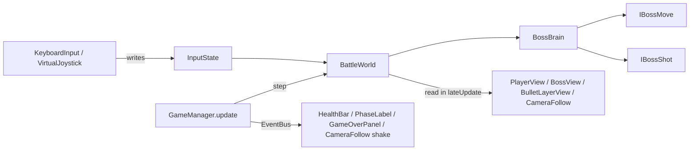

# BulletHell — 2D boss fight demo (Cocos Creator 3.7.4)

A top-down bullet-hell boss battle made for the FGS Client Developer Exercise.
Player = blue circle, player bullets = green circles, boss = red square, boss bullets = orange circles,
inside a large rectangular arena closed by four walls.

## How to run

- **Play in the browser (no install)**: https://claude.ai/artifact/CrUxMfXZBLN7ULPG5nTkXq — tap or press a key to
  start; sound starts after the first tap.
- **Builds (Google Drive)**: https://drive.google.com/drive/folders/1_BiLxdtwbhJzhUI1HPYBFyyndI3hrHCg?usp=sharing `BulletHell.apk` (Android) and `BulletHell-web.zip` (web-mobile).
- **Editor**: open the folder with Cocos Creator **3.7.4** (Dashboard → Projects → Add), open
  `assets/scenes/Main.scene`, press Preview.
- **Web build**: `build/web-mobile/` (not committed; produce it with Project → Build → Web Mobile, or
  `CocosCreator.exe --project <this folder> --build "platform=web-mobile;debug=false"`), then serve it with any
  static server, e.g. `npx http-server build/web-mobile -p 8080`, and open `http://localhost:8080`.

- **Android**: `release/BulletHell.apk` (arm64-v8a, Android 5.0+, landscape). Rebuild: set the Android SDK and
  NDK r21e in Preferences → Program Manager, install JDK 11 (Gradle 6.5 / AGP 4.1 used by 3.7.4), then
  Project → Build → Android (or the same CLI command with `platform=android`) and `gradlew assembleRelease` in
  `build/android/proj`.

### Controls

| Platform | Move | Dash | Shoot | Pause |
| --- | --- | --- | --- | --- |
| Desktop | WASD or arrow keys | Space or Shift | automatic when the boss is within range | Esc or P, or the II button |
| Touch devices | drag on the left half of the screen (floating joystick) | DASH button (bottom right) | automatic | II button (top left), Android back key |

## Constraints of the brief

- **No project template examples**: the project was created from the *Empty (2D)* template (a blank project);
  no code or asset comes from an example project.
- **No third-party packages**: `package.json` has no dependencies and the code only imports the engine (`cc`).
  The sprites (white circle and square) and every sound were generated by code for this project.

## Brief compliance

| Brief requirement | Where |
| --- | --- |
| Blue circle player, green player bullets, red square boss, orange boss bullets | `config/GameConfig.ts` (COLORS), `view/PlayerView`, `view/BossView`, `view/BulletLayerView` |
| Large enclosed arena with four solid walls | `config/GameConfig.ts` (ARENA), `model/ArenaBounds`, `view/ArenaView` |
| Top-down camera | `view/CameraFollow` |
| Player moves freely inside the map | `model/PlayerModel` (clamped by `ArenaBounds`), `input/*` |
| Player auto-shoots when the boss is in range | `model/PlayerWeapon` (AUTO_AIM_RANGE) |
| Fixed player health | `model/Health` (max 100, never restored during a round; the shield orb blocks a hit instead of healing) |
| Normal Move: chase the player | `model/boss/ChaseMove` |
| Dash Move: toward the player's position at activation, direction locked | `model/boss/DashMove` |
| Normal Shoot 6 bullets, Crazy Shoot 18 bullets in a wider fan | `config/BossConfig.ts` (SHOTS), `model/boss/FanShot` |
| High / Medium (random) / Low behaviour by HP | `config/BossConfig.ts` (PHASES), `model/boss/BossBrain` |
| Boss defeated: all bullets destroyed instantly | `controller/GameManager.handleOutcome` → `BattleWorld.clearAllBullets` |
| Game Over screen with Restart when the boss or the player dies | `ui/GameOverPanel`, `GameManager.startGame` |
| Configuration separated from logic | `config/` (GameConfig, BossConfig, AudioConfig, FeedbackConfig) |
| Easy to extend | `IBossMove` / `IBossShot` + `BossActionFactory` (see *Extending the boss*) |
| Optional: player dash, boss VFX by stage; bonus audio | `model/PlayerModel`, `view/BossView`, `view/DashTelegraphView`, `view/ImpactEffects`, `view/AudioPlayer` |
| No example template, no third-party packages; Git repo; Android build | see *Constraints*; `release/BulletHell.apk` |

## Features

Required by the brief, all done:
- Simple shapes with the required colours; large enclosed arena (2400 x 1600 px) with four walls.
- Player: free movement clamped inside the walls, auto-shoots the boss when it is within 750 px, fixed HP (100),
  1 s of invulnerability (blinking) after a hit.
- Boss moves: **Normal** (chases the player continuously) and **Dash** (windup flash, then a high-speed dash toward
  where the player was when the dash was activated, direction locked during the dash, stops at walls).
- Boss shots: **Normal** (6 bullets in a fan toward the player) and **Crazy** (18 bullets in a wider fan).
- Boss behaviour by HP ratio: **High** (>= 60%) Normal move + Normal shot; **Medium** (>= 30%) random Normal/Dash
  move and random Normal/Crazy shot, re-picked independently every 2–4 s; **Low** (< 30%) Dash + Crazy.
- Boss defeated → every bullet on the map is removed instantly.
- Game Over screen with a Restart button when either side dies; its title is "VICTORY" (gold) when the boss is
  defeated and "GAME OVER" (red) when the player is.
- All tuning values in `assets/scripts/config/` (no magic numbers in logic).

Optional and bonus items, also done:
- **Player dash**: 165 px burst in the move direction, 1 s cooldown, invulnerable while dashing (dodge through
  bullets), cooldown shown on the touch button.
- **Gameplay extensions** (the brief's rules are unchanged):
  - **Dash telegraph**: during the windup a line shows the locked dash direction, so the dash is readable and fair.
  - **Shield orb**: each time the boss enters a new phase it drops one orb at least 500 px away from it; picking
    it up gives a shield that absorbs the next hit (the player's HP stays fixed and only goes down).
  - **Round timer and best clear time**, saved on the device (`SaveStore`, versioned and validated).
  - **Phase banner** ("BOSS ENRAGED!", "FINAL PHASE!") with a ring burst and camera shake.
  - **Hit sparks and a boss explosion** (pooled burst nodes, no allocation during play).
- **Audio**: music loop and 13 sound effects generated by code (no third-party assets): player shot (throttled),
  player hit, player dash, shield break, boss hit, boss volley, boss dash, phase change, shield orb pickup,
  explosion, victory, defeat, UI click.
- Visual feedback: boss tint darkens per phase, white flash during the dash windup, purple tint while dashing,
  short flash when the boss is hit, the boss disappears when defeated, player blink while invulnerable, camera shake
  when the player is hit, HP bars and a phase label.
- **Pause menu**: II button, Esc / P or the Android back key; Resume, Restart and Home (back to the start screen).
  The round also pauses itself when the app goes to the background (phone call, tab switch).
- Start screen with the controls; the first round waits until the player taps or presses a key (this is also
  the gesture browsers need before playing audio).
- Smooth follow camera clamped to the arena.
- Virtual joystick and DASH button on touch devices (the keyboard hint is hidden there).
- Multi-screen support: phones (16:9 to 21:9), tablets (4:3) and portrait web, with the HUD kept inside the
  safe area (notches, rounded corners). See *Screen adaptation*.

## Architecture

```
assets/scripts/
  config/      GameConfig (all numbers), BossConfig (moves, shots, phase table), AudioConfig, id enums
  core/        EventBus (global EventTarget), GameEvents (every event name + payload)
  model/       Pure TypeScript simulation, never imports 'cc'
    boss/      IBossMove, IBossShot, ChaseMove, DashMove, FanShot, BossActionFactory, BossBrain
  controller/  GameManager: owns BattleWorld + InputState, state machine, the only gameplay update()
  view/        Components that draw the model (lateUpdate), effects (BurstPool, ImpactEffects,
               DashTelegraphView, PickupView) and AudioPlayer (sound)
  input/       KeyboardInput, VirtualJoystick, DashButton: turn input events into InputState / dash requests
  ui/          HUD, Game Over panel, pause menu, start screen (event driven)
  utils/       Collision, MathUtil
```

Dependencies go one way: `ui`, `view`, `input` → `controller` → `model` → `config`, `core`, `utils`.

### One frame

1. Input components write the movement axes of `InputState` when events arrive (`KeyboardInput`,
   `VirtualJoystick`); a dash key or the DASH button calls `GameManager.requestDash()`, which only accepts it
   while playing.
2. `GameManager.update(dt)` (only while `Playing`) splits the frame into fixed sub-steps of at most 50 ms and calls
   `BattleWorld.step(step, input)` for each:
   player moves → player weapon → `BossBrain` (phase from HP, pick move/shot, step them) → bullet stores move and drop
   bullets at walls → collisions → returns a `BattleOutcome`.
3. `BattleBroadcaster` (owned by `GameManager`) emits `PLAYER_HP_CHANGED` / `BOSS_HP_CHANGED` /
   `BOSS_PHASE_CHANGED` / `*_HIT` only when a value changed, and `PLAYER_SHOT` / `BOSS_VOLLEY_FIRED` /
   `PICKUP_*` at most once per frame by comparing monotonic world counters (several sub-steps may fire in one
   frame). On `BossDefeated` GameManager clears all bullets, records the clear time, then emits `GAME_OVER`.
4. In `lateUpdate`, views copy model state onto nodes: `PlayerView`, `BossView`, two `BulletLayerView`s,
   `CameraFollow`.
5. UI and effects react to events (`HealthBarView`, `PhaseLabelView`, `PhaseBanner`, `GameOverPanel`,
   `ImpactEffects`, `AudioPlayer`); `RoundTimerView` reads the round time and only rebuilds its text once per second.



### Scene (`Main.scene`)

- `GameRoot`: GameManager, KeyboardInput, AudioPlayer with two AudioSources (music, effects).
- `World` (RenderRoot2D, layer DEFAULT): `GameCamera` (orthographic, follows the player), floor and four walls,
  bullet layers, boss, player.
- `Canvas` (layer UI_2D, ScreenAdapter) with its own `UICamera` drawn on top: `SafeArea` (HP bars, phase label,
  controls hint, joystick, DASH button, pause button), Game Over popup, pause menu, start screen.

### Screen adaptation

- **Resolution policy by screen shape** (`ui/ScreenAdapter`): screens at least as wide as 16:9 use Fit Height and
  see more to the sides; narrower screens (4:3 tablets, portrait) use Fit Width and see more above and below. The
  whole 1280x720 design area is therefore always on screen, so no HUD element is ever cut off.
- **Camera zoom** (`view/CameraFollow`): `orthoHeight` is computed from the screen aspect so at least
  1280x720 world px are visible on every device (`CAMERA.MIN_VIEW_WIDTH/HEIGHT`), recomputed on resize/rotation.
- **Safe area**: HP bars, phase label, hint, joystick and DASH button sit under a `SafeArea` node (engine
  component), so notches and rounded corners never cover them; the Game Over blocker still covers the full screen.
- Widgets use `ON_WINDOW_RESIZE` (aligned once and on resize, never every frame). The Android build is locked to
  landscape.

### Extending the boss

- New fan variant: one `BossShotId` value + one entry in `BossConfig.SHOTS` + add the id to a phase.
- New pattern type (e.g. a ring): a class implementing `IBossShot` + enum value + one line in `BossActionFactory`.
- New move: same through `IBossMove`. Phases are data only (`BossConfig.PHASES`).
- Typed `Record<Enum, ...>` tables make a forgotten entry a compile error.

## Decisions and trade-offs

- **Simulation separated from rendering.** All rules live in `model/` as plain TypeScript; components only draw.
  Easier to reason about and test; cost: one copy step per frame in the views.
- **Custom collision math instead of the physics engine.** Only two targets exist (player circle, boss square), so
  circle-vs-circle and circle-vs-box on squared distances is O(n) and cheaper than physics bodies per bullet.
  No spatial grid: with < 200 bullets and one target per side it would add complexity for nothing.
- **Bullets as data.** Each side keeps bullets in fixed-capacity `Float32Array`s (no object per bullet, O(1)
  swap-remove). Rendering uses a preallocated set of node slots per side: nodes are created once (preload + grow up
  to capacity), then only moved and toggled; nothing is instantiated or destroyed during the fight.
- **One update for the whole game.** `GameManager` is the only gameplay `update`; about six `lateUpdate`s in total
  no matter how many bullets there are.
- **Sub-stepping.** A frame is simulated in steps of at most 50 ms, so a slow device (15 fps) still runs at real
  speed and fast bullets cannot skip through a target. Frames longer than 250 ms (GC, debugger) are cut, not
  fast-forwarded.
- **Restart without reloading the scene.** `GameOver → Ready → Playing`; `BattleWorld.reset()` resets every model.
  At launch the first round waits in `Ready` behind the start screen.
- **HP phase thresholds 60% / 30%**, phases only move forward within a round, and a dash is never interrupted by a
  random re-pick (the brain retries once the move is interruptible).
- **Dash direction** is locked when the windup starts (the "moment of activation"), so the windup flash telegraphs
  a fixed direction the player can dodge. The boss aims at the player position clamped into the area its centre can
  reach, so a player hugging a wall makes the boss dash along the wall instead of pinning it there.
- **Chase stop distance (60 px)**: the boss keeps touching (contact damage) but never sits on the player's centre.
- **Shield orb instead of healing**: the brief asks for a fixed player health value, so the extra pickup never
  restores HP; it only blocks one hit. It rewards moving around the arena without changing the brief's rules.
- **Contact damage**: touching the boss costs 20 HP; after any hit the player is invulnerable for 1 s and boss
  bullets pass through instead of being consumed.
- **Same-frame double kill** counts as a victory (boss death is checked first).
- **Pause with `director.pause()`, only through `GameManager`**: one `Paused` state, entered only from Playing.
  `GameManager.pause()` / `resume()` are the only callers of `director.pause()` / `resume()`, so the state machine and
  the engine always agree; Restart, Home and `onDestroy` resume the director first. While paused, update, schedules,
  tweens and widgets stop but input and rendering run, so the pause menu opens without a tween and aligns its widgets
  by hand (`Widget.updateAlignment`). Trade-off: simpler than skipping every update by hand, but every UI shown
  during the pause must follow these two rules.
- **Config as TypeScript `as const` objects** rather than JSON: type-checked (a missing phase/shot entry or an empty
  phase list is a compile error), no async loading or parse-failure path. Trade-off: changing a value needs a rebuild;
  moving `GameConfig` to a `JsonAsset` with a validated loader would allow live tuning.
- **Joystick shown by touch support** (`sys.hasFeature(INPUT_TOUCH)`), not by the user agent, so iPads and touch
  laptops also get it; the keyboard always works.
- **Engine feature cropping**: physics, spine, dragonbones, tiled map, video, webview and particles are disabled to
  keep the build small.

## Memory management

| Opened | Closed | Where |
| --- | --- | --- |
| `EventBus.on` (HealthBarView, PhaseLabelView, GameOverPanel, CameraFollow, BossView) | `EventBus.off` with the same handler and target | `onEnable` ↔ `onDisable` |
| `input.on` KEY_DOWN / KEY_UP, `game.on(EVENT_HIDE)` (KeyboardInput) | `input.off` / `game.off`, held keys released | `onEnable` ↔ `onDisable` |
| `node.on` touch events (VirtualJoystick), Restart button click (GameOverPanel) | `node.off` | `onEnable` ↔ `onDisable` |
| `view.on('canvas-resize')` (CameraFollow, ScreenAdapter) | `view.off` | `onEnable` ↔ `onDisable` |
| `node.on(TOUCH_END)`, `input.on(KEY_UP)` (StartScreen) | `off` (the node hides itself when the round starts) | `onEnable` ↔ `onDisable` |
| Four button clicks, `EventBus.on`, `input.on(KEY_DOWN)`, `game.on(EVENT_HIDE)`, `view.on('canvas-resize')` (PausePanel) | matching `off`; cached widget array cleared | `onEnable` ↔ `onDisable`, `onDestroy` |
| `director.pause()` (GameManager.pause) | `director.resume()` in resume / startGame / returnToTitle / `onDestroy` | GameManager |
| `node.on(TOUCH_START)` (DashButton) | `node.off` | `onEnable` ↔ `onDisable` |
| Music `AudioSource.play()` (loop), `EventBus.on` / `input.on` (AudioPlayer) | `stop()`, `off` | `onEnable` ↔ `onDisable` |
| Victory jingle `scheduleOnce` (AudioPlayer) | `unschedule` on Ready and in `onDisable` | — |
| `EventBus.on` (ImpactEffects, PhaseBanner, CameraFollow) | `EventBus.off` | `onEnable` ↔ `onDisable` |
| Burst nodes `instantiate(prefab)` (BurstPool, created at load) | children of `Effects`, destroyed with it; array cleared | `onDestroy` |
| `sys.localStorage` read/write (SaveStore) | nothing to close; every access in try/catch, never throws | — |
| Bullet slots `instantiate(prefab)` (BulletLayerView) | children of the layer, destroyed with it; slot array cleared | `onDestroy` |
| Bullet stores (`Float32Array`) | allocated once per world, reused across rounds (`clear()` only resets the count) | — |

- No tweens, no dynamic asset loading, no `static` references to nodes; the only schedule is the victory jingle. Audio clips are scene
  references (loaded and released with the scene).
- Checked at runtime (headless Chrome): 12 consecutive Game Over → Restart cycles with effects keep the node count
  constant (307) and every burst returns to idle; 0 console warnings or errors.

## Performance notes

- No allocation in any per-frame path (update, lateUpdate, touch move): module-level scratch objects, cached colours,
  values only assigned to the engine when they change (`node.active`, sprite colour, label string).
- Squared distances for range and collision tests; `atan2` once per volley, not per bullet.
- Two white textures (circle, square) packed into one **Auto Atlas** at build time and tinted by `Sprite.color`,
  so the whole world batches into very few draw calls on every platform (the runtime dynamic atlas is disabled
  on native builds, so it is not relied on).
- Bullet node slots: 32 player / 200 boss created at load; a long simulated fight peaked below 100 boss bullets,
  and if a pattern ever needs more, slots grow once up to the store capacity (400).

## TODO / not done

- Desktop (Windows) build: needs Visual Studio, which was not available on the build machine.
- A data-driven (JSON) config for live tuning without a rebuild (see Decisions).
- More boss patterns (e.g. a ring shot) to show the extension points in action.
